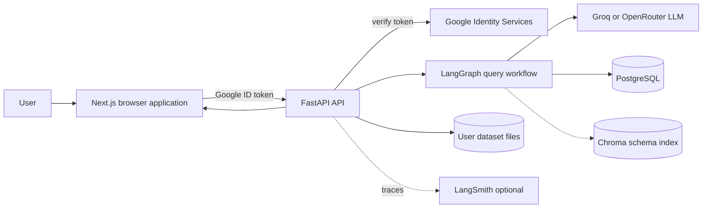
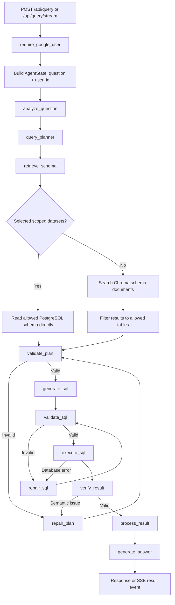
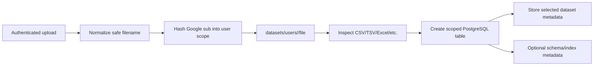

# Text-to-SQL Agent Architecture

This document describes the architecture currently implemented in this
repository. The application converts a user's natural-language question into a
read-only SQL query, executes it against PostgreSQL, and presents the result in
the Next.js interface.

## Complete system architecture

The diagram below combines the interactive request path, dataset ingestion,
schema RAG path, persistence, observability, and offline evaluation path. Solid
arrows represent data or control flow; dashed arrows represent optional,
asynchronous, or evaluation-only integrations.

```mermaid
flowchart LR
    %% -------------------- Client and API boundary --------------------
    subgraph CLIENT["Client"]
        U([User])
        FE["Next.js frontend<br/>frontend/app/page.tsx<br/>query UI, upload, history, analytics"]
        GIS["Google Identity Services<br/>ID token"]
        U --> FE
        FE -. "sign in" .-> GIS
    end

    subgraph SERVICE["Backend service :8000"]
        API["FastAPI application<br/>app/main.py"]
        ROUTES["API routes<br/>/api/auth/google<br/>/api/query + /stream<br/>/api/schema<br/>/api/sql/execute<br/>/api/datasets/*"]
        AUTH["Google auth + user scope<br/>verify credential; hash user sub"]
        GRAPH["LangGraph compiled agent<br/>StateGraph + MemorySaver<br/>AgentState"]
        VALIDATOR["SQL validator<br/>read-only and identifier checks"]
        CONFIG["Environment settings<br/>provider, limits, tracing, paths"]
    end

    FE -->|"Bearer Google ID token<br/>question / files / edited SQL"| API
    API --> ROUTES
    ROUTES -->|"authenticate protected requests"| AUTH
    AUTH -. "credential verification" .-> GIS
    AUTH -->|"user_id + scoped request"| GRAPH
    ROUTES -->|"upload, preview, select"| DATASET
    ROUTES -->|"manual SQL"| VALIDATOR
    CONFIG --> API
    CONFIG --> GRAPH

    %% -------------------- LangGraph workflow --------------------
    subgraph WORKFLOW["LangGraph query workflow"]
        N1["analyze_question"]
        N2["query_planner<br/>structured required tables/columns"]
        N3["retrieve_schema"]
        N4{"validate_plan"}
        N5["repair_plan"]
        N6["generate_sql"]
        N7{"validate_sql"]
        N8["repair_sql"]
        N9["execute_sql"]
        N10{"verify_result"}
        N11["process_result"]
        N12["generate_answer"]
        OUT(["AgentState result<br/>SQL, rows, answer, metadata"])

        N1 --> N2 --> N3 --> N4
        N4 -->|"valid"| N6
        N4 -->|"missing / unanswerable<br/>within correction limit"| N5 --> N4
        N4 -->|"correction limit reached"| N11
        N6 --> N7
        N7 -->|"safe"| N9
        N7 -->|"unsafe or invalid<br/>within retry limit"| N8 --> N7
        N7 -->|"retry limit reached"| N11
        N9 -->|"database error"| N8
        N9 -->|"execution result"| N10
        N10 -->|"valid"| N11
        N10 -->|"semantic issue: SQL"| N8
        N10 -->|"semantic issue: plan"| N5
        N10 -->|"correction limit reached"| N11
        N11 --> N12 --> OUT
    end

    GRAPH --> N1
    OUT -->|"JSON response or SSE progress/result"| ROUTES
    ROUTES --> FE

    %% -------------------- LLM and retrieval --------------------
    subgraph AI["AI services"]
        LLM["LLM provider<br/>Groq ChatGroq or OpenRouter ChatOpenAI"]
        EMB["Embedding provider<br/>HashEmbeddings or HuggingFace"]
        PROMPTS["Prompt templates<br/>planner, SQL, repair, verifier, answer"]
    end

    N2 -->|"planning prompt"| PROMPTS --> LLM
    N6 -->|"schema + plan + question"| PROMPTS
    N8 -->|"validation / execution feedback"| PROMPTS
    N10 -->|"question + SQL + result"| PROMPTS
    N12 -->|"question + SQL + result"| PROMPTS
    PROMPTS --> LLM
    LLM -->|"JSON plan / SQL / verification<br/>or natural-language answer"| N2
    LLM --> N6
    LLM --> N8
    LLM --> N10
    LLM --> N12

    subgraph RAG["Schema RAG / ChromaDB"]
        DOCS["Schema document builder<br/>tables, columns, relationships"]
        RETRIEVER["Scoped schema retriever<br/>selected dataset direct path<br/>otherwise similarity search"]
        CHROMA[("ChromaDB persistent collection<br/>schema_metadata<br/>./chroma")]
        DOCS -->|"Document objects"| EMB
        EMB -->|"vectors"| CHROMA
        RETRIEVER -->|"question + query plan"| EMB
        EMB -->|"query embedding"| CHROMA
        CHROMA -->|"top-k schema documents"| RETRIEVER
        RETRIEVER -->|"schema_context, tables,<br/>columns, relationships"| N3
    end

    N3 --> RETRIEVER
    N3 -. "active scoped dataset:<br/>bypass shared vector store" .-> SCHEMA

    %% -------------------- Data and persistence --------------------
    subgraph DATA["Data and persistence"]
        DATASET["Dataset lifecycle<br/>safe filenames, CSV/TSV/Excel/JSON/JSONL/<br/>Parquet/XML/YAML inspection"]
        FILES[("datasets/<br/>users/<user_scope>/*")]
        SQLALCHEMY["SQLAlchemy engine<br/>connection.py"]
        SCHEMA["Schema introspection<br/>tables, columns, FKs, inferred relationships"]
        DB[("PostgreSQL :5432<br/>public demo tables + scoped dataset tables")]
        RESULT["Bounded execution result<br/>columns, rows, row_count,<br/>truncated, execution_time"]
        DATASET -->|"store upload"| FILES
        DATASET -->|"infer schema + load rows"| SQLALCHEMY
        SQLALCHEMY --> DB
        SCHEMA -->|"inspect metadata"| SQLALCHEMY
        SQLALCHEMY -->|"execute validated SQL"| DB
        DB --> RESULT
    end

    ROUTES --> DATASET
    DATASET --> SCHEMA
    SCHEMA --> RETRIEVER
    N3 --> SCHEMA
    N9 --> VALIDATOR
    VALIDATOR -->|"validated read-only SQL"| SQLALCHEMY
    SQLALCHEMY --> RESULT --> N9
    SCHEMA --> VALIDATOR
    ROUTES --> SCHEMA
    FILES -. "mounted volume / local runtime" .-> DATASET

    %% -------------------- Operations and evaluation --------------------
    subgraph OPS["Tracing and offline evaluation"]
        LANGSMITH["LangSmith<br/>optional run tracing<br/>project: text-to-sql-agent"]
        EVAL["evaluation/runner.py<br/>offline benchmark orchestration"]
        CASES[("evaluation/datasets/<br/>text_to_sql.json")]
        BASELINE["Reference SQL execution<br/>exact match, syntax,<br/>execution and schema accuracy"]
        DEEPEVAL["DeepEval<br/>contextual relevancy / precision / recall<br/>answer relevancy / faithfulness"]
        REPORTS[("evaluation/reports/<br/>latest.json + latest.md")]
        EVAL -->|"seed + ingest"| DB
        EVAL -->|"invoke same graph"| GRAPH
        CASES --> EVAL
        EVAL --> BASELINE
        EVAL -->|"question, answer,<br/>retrieved context"| DEEPEVAL
        BASELINE --> EVAL
        DEEPEVAL --> REPORTS
        EVAL --> REPORTS
    end

    API -. "LangChain/LangGraph callbacks<br/>when LANGSMITH_TRACING=true" .-> LANGSMITH
    GRAPH -. "workflow spans and metadata" .-> LANGSMITH
    LLM -. "provider calls / latency" .-> LANGSMITH
    FE -. "evaluation status endpoint<br/>(informational only)" .-> ROUTES

    %% -------------------- Styling --------------------
    classDef client fill:#e8f1ff,stroke:#3973c6,color:#102a43
    classDef service fill:#e9f8ef,stroke:#2f855a,color:#173b27
    classDef workflow fill:#fff4d6,stroke:#b7791f,color:#4a2c00
    classDef ai fill:#f3e8ff,stroke:#805ad5,color:#32204f
    classDef data fill:#ffe9e5,stroke:#c53030,color:#4a1712
    classDef ops fill:#e6fffa,stroke:#2c7a7b,color:#173b3b
    class U,FE,GIS client
    class API,ROUTES,AUTH,VALIDATOR,CONFIG service
    class GRAPH,N1,N2,N3,N4,N5,N6,N7,N8,N9,N10,N11,N12,OUT workflow
    class LLM,EMB,PROMPTS,RAG,RETRIEVER,DOCS,CHROMA ai
    class DATA,DATASET,FILES,SQLALCHEMY,SCHEMA,DB,RESULT data
    class OPS,LANGSMITH,EVAL,CASES,BASELINE,DEEPEVAL,REPORTS ops
```

## System context



## Repository structure

```text
text-to-sql-agent/
├── frontend/                  # Next.js UI and browser-side auth state
│   └── app/page.tsx           # Query, upload, results, history, analytics
├── backend/
│   ├── app/
│   │   ├── main.py            # FastAPI application and middleware
│   │   ├── api/routes.py      # Auth, query, schema, SQL, dataset endpoints
│   │   ├── agent/
│   │   │   ├── graph.py       # LangGraph topology
│   │   │   ├── nodes.py       # Workflow node implementations
│   │   │   └── state.py       # Typed workflow state
│   │   ├── database/
│   │   │   ├── connection.py  # SQLAlchemy engine/session
│   │   │   ├── schema.py      # Visible schema and user isolation
│   │   │   ├── executor.py    # Bounded SQL execution
│   │   │   └── dataset_intelligence.py
│   │   ├── rag/
│   │   │   ├── retriever.py   # Scoped schema retrieval
│   │   │   ├── vectorstore.py # Chroma access
│   │   │   └── ingest.py      # Schema index creation
│   │   ├── llm/               # Provider factory and prompts
│   │   ├── security/          # Google auth and SQL validation
│   │   └── config.py          # Environment-backed settings
│   └── tests/
├── datasets/                  # Runtime uploads; not committed
├── chroma/                    # Local persistent vector store
├── database/                  # Local database artifacts
├── docker-compose.yml         # Local PostgreSQL/backend/frontend stack
└── render.yaml                # Render backend deployment definition
```

## Main query flow



The streaming endpoint emits progress events for workflow nodes and then a
final result event. The regular endpoint waits for the complete graph run.

## Dataset ingestion and isolation



The authenticated Google `sub` is normalized to `user["id"]`. A stable hash of
that identifier creates the filesystem and table namespace:

```text
datasets/users/<user_scope>/
dataset_<user_scope>_<dataset_name>
```

Every schema lookup receives the authenticated user ID. User-owned dataset
tables are included only when their scope matches that ID. Built-in demo tables
are intentionally shared. Manual SQL execution uses the same filtered schema
before validation, so a user cannot query another user's uploaded table through
the API.

For an active selected dataset, retrieval bypasses Chroma and reads the
authenticated user's scoped database schema directly. This avoids stale or
cross-user vector results. Chroma is used for general schema retrieval when no
selected dataset is available; returned documents are filtered against the
allowed table set.

## LangGraph components

| Node | Responsibility |
| --- | --- |
| `analyze_question` | Normalize and classify the question |
| `query_planner` | Produce a structured table/column plan |
| `retrieve_schema` | Provide relevant, user-scoped schema context |
| `validate_plan` | Check planned tables and columns |
| `generate_sql` | Ask the configured LLM for PostgreSQL SQL |
| `validate_sql` | Reject writes, multiple statements, comments, unknown identifiers, and unsafe patterns |
| `repair_plan` / `repair_sql` | Bounded self-correction using validation or execution feedback |
| `execute_sql` | Run validated read-only SQL with result limits |
| `verify_result` | Detect empty, inconsistent, or semantically incorrect results |
| `process_result` | Normalize rows, columns, metadata, and timing |
| `generate_answer` | Convert the result into a natural-language response |

The graph uses `MemorySaver` with a generated request thread ID. Retry and
correction limits are controlled by environment settings such as
`MAX_SQL_RETRIES` and `MAX_CORRECTION_ATTEMPTS`.

## Security boundaries

1. Google ID tokens are verified by the backend against `GOOGLE_CLIENT_ID`.
2. Protected endpoints derive the user identity from the verified token, not
   from a request body field.
3. Dataset paths and PostgreSQL table names are user-scoped.
4. Schema discovery and manual SQL validation use the authenticated user's
   allowed tables and columns.
5. SQL validation runs before execution and rejects write operations and
   unsafe or unsupported statements.
6. Results are capped by `MAX_RESULT_ROWS`.
7. LLM credentials remain server-side environment variables; they are never
   sent to the browser.

## Deployment topology

### Local Docker Compose

```mermaid
flowchart TB
    F[frontend:3000] --> B[backend:8000]
    B --> P[(postgres:5432)]
    B --> C[/chroma volume]
    B --> D[/datasets volume]
    B --> L[LLM provider]
```

`docker-compose.yml` starts PostgreSQL first, then seeds the database, ingests
schema documents, and starts Uvicorn. The frontend is built with the backend
URL supplied through `NEXT_PUBLIC_API_URL`.

### Hosted deployment

```text
Browser
  └── Vercel: Next.js frontend
        └── Render: FastAPI backend container
              ├── Neon/PostgreSQL: DATABASE_URL
              ├── Google: ID-token verification
              └── Groq/OpenRouter: SQL and answer generation
```

The Render service is defined in [`render.yaml`](./render.yaml). The frontend
must point `NEXT_PUBLIC_API_URL` at the deployed backend, and the backend
`CORS_ORIGINS` must include the deployed frontend origin.

## Request and data contracts

### Authentication

```text
POST /api/auth/google
{ "credential": "<Google ID token>" }
→ { "user": { "id", "name", "email", "picture" } }
```

### Query

```text
POST /api/query
Authorization: Bearer <Google ID token>
{ "question": "Show the top restaurants by rating" }
```

`POST /api/query/stream` returns Server-Sent Events with progress updates and a
final result payload.

### Dataset lifecycle

```text
POST /api/datasets/upload
GET  /api/datasets
POST /api/datasets/select
POST /api/datasets/index
GET  /api/schema
```

The uploaded Zomato CSV is treated like any other user dataset: it is stored
under the authenticated user's scope, inspected, loaded into that user's
scoped PostgreSQL table, and exposed to the query workflow only after selection.

## Operational considerations

- Persist PostgreSQL data with a managed database or a durable Docker volume.
- Persist dataset files if uploads must survive container restarts.
- Persist or rebuild Chroma consistently with the configured embedding provider.
- Set `GOOGLE_CLIENT_ID`, `DATABASE_URL`, `CORS_ORIGINS`, and the selected LLM
  API key in the deployment environment.
- Do not commit `.env`, API keys, uploaded datasets, Chroma databases, or local
  database files.
- Use `/health` for backend readiness checks.

